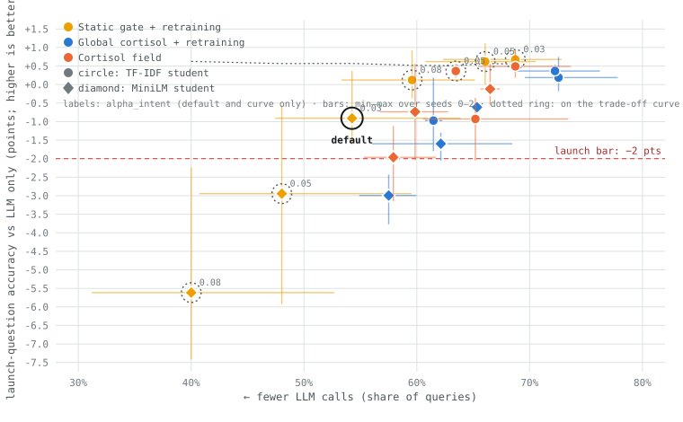

# Guarded Distillation

**Half the LLM calls, about the same accuracy, and a gate that knows when to hand a question back.**

A support bot that asks a large LLM about every message pays for the same answer over and over.
This project compiles the LLM's repeated decisions into small CPU models trained on its own
answers, puts a risk-controlled gate in front of them, and keeps them honest as the world changes
(a product launch, an off-topic surge) without anyone watching.

On 8,000 real customer questions with Claude Haiku 5.5 as the teacher (three held-out runs): about
50% of the LLM calls, $0.021 instead of $0.041 per 1,000 questions, accuracy 81.4% against 80.8%
for the LLM alone, and 84.5% against 84.8% on questions about a newly launched product. The misses
are documented as carefully as the wins (see "What didn't work" below and docs/RESULTS.md).

- **Story for non-specialists:** https://guarded-distillation.vercel.app (source in `site/`, deploy from that folder: `vercel deploy --prod`)
- **Live replay of one run:** https://guarded-distillation.vercel.app/replay
- **Full results, with every caveat:** `docs/RESULTS.md`; theory and guarantee in `docs/THEORY.md`

What is in the repo: a Python package (`guarded_distillation`) with a `gdistill` CLI; a replay
engine that simulates a support inbox; students (TF-IDF and frozen MiniLM embeddings); a conformal
risk-control gate; a spend-capped Claude labelling pipeline; and the experiment scripts behind every
number. 43 tests.

## Routing: which score decides when to ask the LLM?

At matched LLM-call budgets, a **learned router** (logistic regression predicting "the student disagrees with the
teacher", trained online with audit weights, inside the same risk-controlled gate) beats the original margin score on
all three streams: e.g. at 40% calls on the Banking77 launch it is +0.4 pts overall and +9.6 pts on new-product
questions in the first 600 launch-phase queries. The old margin score is the weakest static score; plain
max-probability is a better one-line default. Online Cascade Learning (their public code, run on our streams)
has a cliff and does not reach the 40-60% budgets on two of three streams. Tables and caveats: `docs/RESULTS.md`
(Routing benchmark); numbers in `docs/routing.json`; plot `docs/routing.svg`.

## What didn't work

- The original idea, a "cortisol field" of local stress, did not beat a plain gate with retraining.
  It stays in the code, labelled experimental.
- The first recommended setting lost 3.4 points on new-product questions on held-out runs; class-balanced
  retraining fixed most of it (found after seeing the held-out result, so those numbers are not a fully
  clean test).
- A per-topic stress variant ("semantic cortisol") helps when new intents resemble old ones, not when
  they are far away; a whole new domain remains hard for every setting.

## Quick start

```bash
python3.11 -m venv .venv && source .venv/bin/activate   # Homebrew Python 3.11, same as ../vaers
pip install -e ".[dev]"
python -m pytest -q
gdistill demo                # downloads data, simulated teacher, 5 methods, report (~3 min, free)
open runs/simulated-s0/replay.html
```

## Results (simulated teacher, 3 seeds)

| Method | Accuracy vs LLM only | LLM calls | Product-launch questions |
|---|---|---|---|
| LLM only | baseline | 100% | 94.5% |
| Static gate | −1.9 pts | 46% | 76% |
| Static gate + retraining | −0.25 pts | 47% | 93% |
| Global cortisol | −0.26 pts | 48% | 93% |
| Cortisol field | −0.35 pts | 47% | 92% |

About half the LLM calls at a third of a point of accuracy, with no human step through a launch
and a surge. Retraining does most of the work; the local field has not yet shown an advantage on
this stream. See docs/RESULTS.md, and docs/ROADMAP.md for the experiments that test it.

## Recommended setting (Claude Haiku 5.5 as the teacher)

Chosen on seeds 0-2 from an 18-setting grid: the fewest LLM calls such that overall accuracy is
within 0.3 pts of LLM only **and** launch-question accuracy within 2 pts, on every seed
(docs/RESULTS.md). **Static gate + retraining, MiniLM student, `alpha_intent` 0.03.**

| Seeds 3-5 (held out) | Accuracy | LLM calls | Cost / 1,000 queries | Cheap-path errors / 1k | Launch questions |
|---|---|---|---|---|---|
| LLM only (Haiku) | 80.8% | 100% | $0.041 | 0 | 84.8% |
| Recommended, no balancing | 81.3% (+0.45 pts) | 51% (46-58) | $0.021 | 43 | 81.4% (-3.4 pts) |
| Recommended + balanced retraining | +0.57 pts | 50% (46-58) | n/a | 42 | -0.3 pts |

**Held-out caveat:** with the recommended setting as first chosen (no class balancing), overall
accuracy and call savings held up but launch-question accuracy did not (-3.4 pts, two of three seeds
missed the -2 pt bar). Class-balanced retraining (a new intent is weighted up to the size of its
nearest old neighbour until it has 50 labels; `--preset recommended` now turns it on) fixes most of
it: on seeds 3-5, 50% LLM calls, +0.57 pts overall, launch -0.3 pts, 42 cheap-path errors / 1k. That
fix was found after seeing the seeds 3-5 result, so those numbers are no longer a clean held-out test
of the preset.



```bash
pip install -e ".[llm,sbert]"
gdistill replay --run runs/<run> --preset recommended
gdistill report --run runs/<run> --focus retrain
```

**The cortisol field (the local, per-region part) is experimental.** It is on the trade-off
curve at one point only and no experiment has shown it beating the static gate with retraining.

**Semantic cortisol (experimental, `semantic` method):** per-intent stress on a graph of intents,
instead of k-means cells. On seeds 3-5, at 57% LLM calls it reaches launch accuracy +0.4 pts vs
LLM only and 0.0 in the first 600 launch-phase queries; the balanced plain gate at the same calls is
-0.3 and -2.4. The gain comes from per-intent error residuals spread to graph neighbours; the new-intent,
fit-check and LLM-sensor parts add little (the LLM sensor as specified never fired). Three seeds, tuned
on 0-2 with more freedom than the baseline; see docs/RESULTS.md. **On a CLINC150 domain holdout (a whole
new 15-intent domain as the launch event) it does not carry over cleanly:** better than the matched
balanced gate on the adjacent `credit_cards` domain (launch -2.1 vs -3.2 pts), no better on `travel`
(-3.2 vs -3.8), and no setting meets the -2 pt launch bar there.

## Real teachers

```bash
pip install -e ".[llm]"
# local model behind any OpenAI-compatible server (vLLM, Ollama), free
gdistill label --teacher openai --model <name> --base-url http://host:8000/v1 --price free --run runs/local-s0 --yes
gdistill replay --run runs/local-s0
gdistill report --run runs/local-s0
```

Claude works too (`--teacher anthropic --model claude-haiku-5-5`, key in `.env`); without `--yes` it
only prints the cost estimate. To label a whole dataset once with a spend cap, then replay any seed
for free: `gdistill label-pool ... --cap-usd 5 --yes`, then `gdistill label --labels labels/<model>.jsonl`.

Teacher labels do not depend on the method, so each stream is labelled once and every method
replays from the cache. Each method is charged only for the calls it makes.

## Repository

| path | what |
|---|---|
| `guarded_distillation/engine.py` | the replay loop: gates, escalation, audits, cortisol, retraining |
| `guarded_distillation/gate.py` | doubt, leak bound, the cortisol field, `aci_update` |
| `guarded_distillation/student.py`, `space.py`, `embed.py` | compiled models (TF-IDF or MiniLM); the map space and its cells |
| `guarded_distillation/teacher.py` | simulated, Anthropic and OpenAI-compatible teachers |
| `guarded_distillation/data.py`, `taxonomy.py` | datasets, the drift stream, routing tables |
| `guarded_distillation/report.py`, `templates/replay.html` | REPORT.md, results.json, the replay dashboard |
| `docs/THEORY.md` | lessons, the leak guarantee and its proof sketch, the research question |
| `docs/DESIGN.md` | why each piece is built the way it is |
| `docs/RESULTS.md`, `docs/ROADMAP.md` | numbers so far; what to run next |
| `scripts/` | `grid.py` (run the operating-point grid), `operating_points.py` (select, plot), `seed_table.py` |

## Data

Banking77 (PolyAI, CC-BY-4.0) and CLINC150 out-of-scope queries (CC-BY-3.0), downloaded from their
GitHub repositories with pinned SHA-256 hashes.
