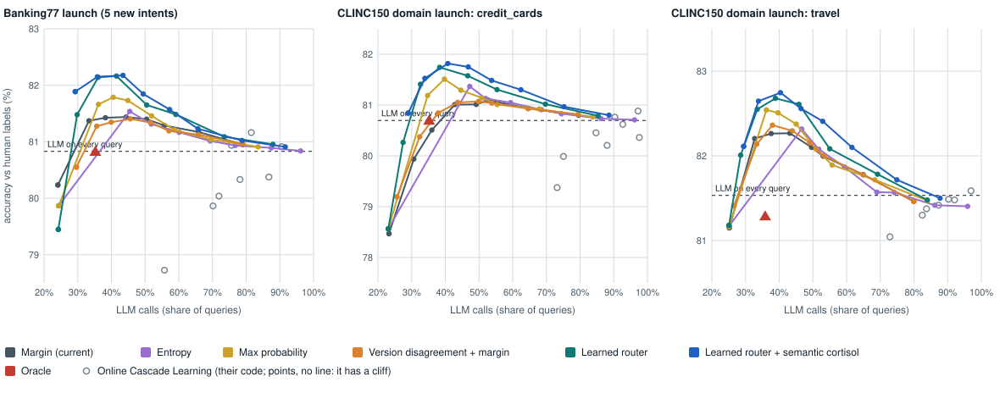

# Results

Two teachers, same streams and settings: 4,000 shadow-mode queries then 8,000 live queries,
default EngineConfig (not re-tuned for the real teacher). Accuracy is always against the human
labels; the system only sees teacher labels.

1. **Simulated teacher** (93% accurate, errors concentrated on ambiguous queries). Shows the
   mechanism, not a real LLM.
2. **Claude Haiku 5.5** (E1, real LLM, 1-shot-per-intent prompt). Section below.

The original **cortisol field** (the global and local stress levels the project started with) did not earn a place in the recommended
setting; its rows and analysis are in **Appendix A** at the end of this file. The tables below show the methods that matter for the
recommendation.

Reproduce the simulated runs: `gdistill demo --seed K --run runs/simulated-sK` for K = 0, 1, 2.

## Headline, simulated teacher (3 seeds)

| Method | Accuracy (s0 / s1 / s2) | Δ vs LLM only, mean | LLM calls, mean | Launch questions, mean | Cheap-path errors / 1k, mean |
|---|---|---|---|---|---|
| LLM only | 92.85 / 92.81 / 92.50 | baseline | 100% | 94.5% | 0 |
| Static gate | 91.37 / 90.60 / 90.46 | −1.91 pts | 46.3% | 76.1% | 34.0 |
| Static gate + retraining | 92.50 / 92.61 / 92.31 | −0.25 pts | 46.7% | 93.3% | 13.0 |

Cost at Claude Haiku 5.5 list prices (seed 0; token counts calibrated on the real Haiku pilot):
LLM only $0.041 per 1,000 queries, cortisol field $0.019. At these prices the dollars are small; the case for compiling is volume, latency, owning
the model, and pricier teachers.

## Headline, Claude Haiku 5.5 teacher (3 seeds)

Teacher accuracy against the human labels: **80.7 / 79.9 / 80.8%** (seeds 0 / 1 / 2) on the live
stream, versus 92.8% for the simulated teacher. Over the whole 14,194-text pool it is 81.1%:
79.5% on the 77 Banking77 intents, 98.7% on out-of-scope. The misses are near-synonym intents
(`balance_not_updated_after_bank_transfer` vs `pending_transfer` / `transfer_timing`,
`direct_debit_payment_not_recognised` vs `card_payment_not_recognised`, `beneficiary_not_allowed`
vs `declined_transfer`). The simulated teacher was too kind.

| Method | Accuracy (s0 / s1 / s2) | Δ vs LLM only, mean | LLM calls, mean | Launch questions, mean | Off-topic questions, mean | Cost per 1,000 queries, mean | Cheap-path errors / 1k, mean |
|---|---|---|---|---|---|---|---|
| LLM only | 80.7 / 79.9 / 80.8 | baseline | 100% | 84.6% | 98.6% | $0.0410 | 0.0 |
| Static gate | 81.0 / 80.0 / 80.9 | +0.17 pts | 71% | 81.3% | 98.4% | $0.0293 | 28.3 |
| Static gate + retraining | 81.2 / 80.5 / 81.4 | +0.57 pts | 69% | 85.2% | 98.6% | $0.0282 | 23.9 |

Cost is the real token usage Haiku returned (about 3,330 cached prompt tokens read per call, 24
uncached input, 10 output) at the `haiku-5.5` price profile: $0.10 / $0.50 per million input /
output tokens, cache reads $0.01. Labelling the whole pool once cost **$0.58** (14,194 calls,
$0.000041 each); every seed's stream is read from that shared cache.

Seed 0 by phase (accuracy / LLM calls):

| Method | steady | launch | off-topic surge | settle |
|---|---|---|---|---|
| LLM only | 79.4% / 100% | 81.1% / 100% | 83.7% / 100% | 80.1% / 100% |
| Static gate | 79.9% / 72% | 81.2% / 77% | 83.7% / 76% | 80.7% / 74% |
| Static gate + retraining | 79.8% / 71% | 81.5% / 74% | 83.7% / 75% | 81.0% / 63% |

### Reading the Haiku results

1. **Compiling still removes LLM calls, but fewer: about 27–31% instead of ~53%.** Cost falls from
   $0.041 to $0.028–0.030 per 1,000 queries. The likely reason (not tested): Haiku's labels on
   confusable intents are noisy, so a student agrees with the teacher less often at any given
   confidence, and the gate, which controls disagreement with the teacher, has to escalate more.
2. **No accuracy loss against the human labels.** Every compiled method is +0.2 to +0.6 pts above
   Haiku. That is inside the noise (one method on one seed has a standard error of about 0.45
   pts at 8,000 queries; I have not run a paired test), so read it as "no measurable loss", not
   "the student beats the teacher".
3. **Retraining still matters at the launch.** The gate that never retrains drops to 81.3% on
   launch questions (−3.3 pts vs Haiku); every retraining variant is at 84.7–85.2%, level with
   Haiku. Same direction as the simulated runs, smaller gap.
4. **The original cortisol field** (global and local) shows no clear advantage here either; see Appendix A.

## Tuning `alpha_intent` on Haiku (seed 0, then seeds 1-2)

`alpha_intent` is the leak budget for in-scope answers (default 0.03). Swept over 0.03, 0.05 and
0.08 on seed 0 with the Haiku labels, all five methods each time. Cells are LLM calls / accuracy
vs LLM only:

| Method | 0.03 (default) | 0.05 | 0.08 |
|---|---|---|---|
| Static gate | 74% / +0.3 | 68% / +0.2 | 62% / −0.2 |
| Static gate + retraining | 71% / +0.4 | 67% / +0.5 | 60% / +0.4 |
| Global cortisol | 70% / +0.4 | 76% / +0.4 | 61% / +0.6 |
| Cortisol field | 65% / +0.6 | **63% / +0.6** | 73% / +0.3 |

Rule: the highest-savings value with accuracy ≥ −0.3 pts vs LLM only, applied to the Cortisol field
(the full method). All three values pass the accuracy bar, so the pick is **0.05** (fewest calls).
Seeds 1-2 at 0.05, next to the default:

| Method | LLM calls, 0.03 → 0.05 | Cheap-path errors / 1k, 0.03 → 0.05 | Δ vs LLM only, 0.05 |
|---|---|---|---|
| Static gate | 71% → 65% | 28.3 → 44.8 | −0.03 pts |
| Static gate + retraining | 69% → 66% | 23.9 → 30.9 | +0.57 pts |
| Global cortisol | 73% → 72% | 18.1 → 26.6 | +0.40 pts |
| Cortisol field | 69% → **63%** | 23.8 → 36.2 | +0.50 pts |

(Full 3-seed table at 0.05 is in the E2 section, as the TF-IDF reference.) The field saves 6 more
points of LLM calls at the same accuracy, and the extra savings are paid for in cheap-path errors
(a looser leak budget lets more disagreements through), so this is a trade, not a free gain.

Caveats on the tuning:
- The curves are not monotone (the field uses more calls at 0.08 than at 0.03; global uses more at
  0.05 than at 0.03). With one seed and three values I read that as noise in when retrains and
  audits fall, not a trend; I did not test it.
- The pick is for the field only. At each method's own best seed-0 value, the field (63%) saves
  **no more** than static + retraining (60% at 0.08) or global (61% at 0.08). So this does not
  show an advantage for the local field. Seed 0 only; the baselines were not rerun at 0.08 on
  seeds 1-2.

## E2: frozen MiniLM embeddings + logistic regression (Haiku, `alpha_intent` 0.05, 3 seeds)

`gdistill replay --map sbert` runs both the map space and the students on `all-MiniLM-L6-v2`
embeddings (frozen), with a logistic-regression head instead of TF-IDF + linear SVM. Same labels,
streams and settings as the TF-IDF table, so the two are directly comparable.

TF-IDF student (reference, α = 0.05):

| Method | Accuracy (s0 / s1 / s2) | Δ vs LLM only, mean | LLM calls, mean | Launch questions, mean | Off-topic questions, mean | Cost per 1,000 queries, mean | Cheap-path errors / 1k, mean |
|---|---|---|---|---|---|---|---|
| LLM only | 80.7 / 79.9 / 80.8 | baseline | 100% | 84.6% | 98.6% | $0.0410 | 0.0 |
| Static gate | 80.9 / 79.8 / 80.6 | −0.03 pts | 65% | 78.6% | 98.2% | $0.0267 | 44.8 |
| Static gate + retraining | 81.2 / 80.5 / 81.4 | +0.57 pts | 66% | 85.2% | 98.5% | $0.0271 | 30.9 |
| Global cortisol | 81.1 / 80.3 / 81.2 | +0.40 pts | 72% | 84.9% | 98.6% | $0.0296 | 26.6 |
| Cortisol field | 81.3 / 80.3 / 81.3 | +0.50 pts | 63% | 85.0% | 98.6% | $0.0260 | 36.2 |

MiniLM student (E2, α = 0.05):

| Method | Accuracy (s0 / s1 / s2) | Δ vs LLM only, mean | LLM calls, mean | Launch questions, mean | Off-topic questions, mean | Cost per 1,000 queries, mean | Cheap-path errors / 1k, mean |
|---|---|---|---|---|---|---|---|
| LLM only | 80.7 / 79.9 / 80.8 | baseline | 100% | 84.6% | 98.6% | $0.0410 | 0.0 |
| Static gate | 80.5 / 80.3 / 80.1 | −0.17 pts | 51% | 72.0% | 97.5% | $0.0210 | 63.5 |
| Static gate + retraining | 81.3 / 80.7 / 81.6 | +0.73 pts | 48% | 82.9% | 97.6% | $0.0196 | 56.8 |
| Global cortisol | 81.0 / 80.4 / 81.2 | +0.40 pts | 60% | 83.1% | 98.0% | $0.0247 | 38.7 |
| Cortisol field | 80.9 / 80.4 / 81.4 | +0.43 pts | 63% | 83.6% | 98.5% | $0.0256 | 37.5 |

Reading (the roadmap expected "a larger accepted share at the same leak budget"; the result is
mixed):

1. **The embedding student answers more, but leaks more.** The ungoverned gates drop from 65-66% to
   48-51% LLM calls, and their cheap-path errors rise from 31-45 to 57-64 per 1,000. Accuracy
   against the human labels holds for retraining (+0.73 pts) and is slightly lower for the static
   gate (−0.17 pts), with a weaker launch result (72.0% vs 78.6%).
2. **The cortisol methods give the savings back for safety.** Global cortisol goes from 72% to 60%
   LLM calls, at 38.7 errors per 1,000 (up from 26.6). The field is unchanged at 63% calls and 37.5
   errors (36.2 before). Neither uses fewer calls than static + retraining (48%) in this setup, but
   both hold errors well below it (37-39 vs 57).
3. **So the clean E2 claim ("same leak budget, more answered") is only partly supported:** it holds
   for global cortisol (12 fewer points of calls, at more errors) and not for the field. I cannot
   say how much comes from the embedding student versus the embedding map, because `--map sbert`
   changed both; `--student tfidf --map sbert` and the reverse would separate them (not run).
4. **Cost of running it.** Encoding the 12,000 stream texts took about 45 s with three replays
   running at once; encoding the whole 14,272-text pool alone takes 14 s (about 1 ms per text,
   batched, on this laptop CPU). With the encodings cached, a method's replay took 2-24 s against 5-66 s for
   TF-IDF, since the dense logistic regression refits faster than the sparse n-gram SVM. In
   production the encoder would run on every query, including escalated ones.
5. No local-field advantage here either: field vs global is 63% vs 60% calls with 37.5 vs 38.7
   errors.

## Operating points: choosing the default (Haiku)

Grid on seeds 0-2: method {static + retraining, global cortisol + retraining, cortisol field} ×
`alpha_intent` {0.03, 0.05, 0.08} × student {TF-IDF, MiniLM}, TF-IDF map throughout so only the
student changes. All Haiku labels are cached, so every cell is free. "Δ" is accuracy vs LLM only
in points; ranges are the lowest and highest of the three seeds. **Launch Δ** is accuracy on the
launch-phase questions (the new product's intents, about 540 live queries per seed), the drift the
system exists to survive.

| Method | Student | α | LLM calls, mean [range] | Launch Δ vs LLM only, pts, mean [range] | Overall Δ, pts, mean [range] | Cheap-path errors / 1k, mean [range] | Passes both bars on every seed | On curve |
|---|---|---|---|---|---|---|---|---|
| Static gate + retraining | MiniLM | 0.08 | 40% [31–53] | -5.61 [-7.42–-2.24] | 0.62 [0.49–0.74] | 90.3 [82.9–104.0] | no | yes |
| Static gate + retraining | MiniLM | 0.05 | 48% [41–60] | -2.94 [-5.94–-0.56] | 0.57 [0.25–0.89] | 58.4 [52.1–66.5] | no | yes |
| Static gate + retraining | MiniLM | 0.03 | 54% [47–64] | -0.91 [-1.62–0.37] | 0.57 [0.46–0.68] | 38.7 [34.4–43.9] | yes | yes **← default** |
| Global cortisol + retraining | MiniLM | 0.08 | 58% [55–60] | -2.99 [-3.77–-2.43] | 0.37 [0.20–0.45] | 58.7 [56.4–62.8] | no | no |
| Cortisol field | MiniLM | 0.08 | 58% [55–62] | -1.96 [-3.15–-1.12] | 0.44 [0.26–0.58] | 56.0 [54.0–57.8] | no | no |
| Static gate + retraining | TF-IDF | 0.08 | 60% [53–65] | 0.12 [-0.37–0.93] | 0.52 [0.40–0.71] | 46.7 [43.8–49.9] | yes | yes |
| Cortisol field | MiniLM | 0.05 | 60% [57–63] | -0.73 [-2.04–0.56] | 0.52 [0.26–0.76] | 42.8 [41.6–43.8] | no | no |
| Global cortisol + retraining | TF-IDF | 0.08 | 61% [61–62] | -0.97 [-1.80–0.19] | 0.47 [0.30–0.61] | 47.9 [43.2–52.6] | yes | no |
| Global cortisol + retraining | MiniLM | 0.05 | 62% [56–68] | -1.60 [-2.05–-1.30] | 0.38 [0.16–0.54] | 39.2 [33.2–45.5] | no | no |
| Cortisol field | TF-IDF | 0.05 | 63% [63–64] | 0.37 [0.19–0.56] | 0.51 [0.42–0.59] | 36.2 [34.2–39.6] | yes | yes |
| Cortisol field | TF-IDF | 0.08 | 65% [61–73] | -0.93 [-2.05–-0.36] | 0.43 [0.27–0.51] | 44.3 [33.9–51.8] | no | no |
| Global cortisol + retraining | MiniLM | 0.03 | 65% [65–66] | -0.61 [-0.72–-0.56] | 0.30 [0.30–0.30] | 24.8 [22.1–27.6] | yes | no |
| Static gate + retraining | TF-IDF | 0.05 | 66% [61–71] | 0.62 [0.00–1.11] | 0.57 [0.46–0.65] | 30.9 [29.6–33.0] | yes | yes |
| Cortisol field | MiniLM | 0.03 | 66% [66–67] | -0.12 [-0.56–0.56] | 0.36 [0.27–0.42] | 25.2 [23.1–27.0] | yes | no |
| Static gate + retraining | TF-IDF | 0.03 | 69% [62–73] | 0.68 [0.36–0.93] | 0.55 [0.45–0.69] | 23.9 [22.6–24.8] | yes | yes |
| Cortisol field | TF-IDF | 0.03 | 69% [65–74] | 0.49 [0.19–0.93] | 0.47 [0.30–0.57] | 23.8 [18.1–27.6] | yes | no |
| Global cortisol + retraining | TF-IDF | 0.05 | 72% [69–76] | 0.37 [0.19–0.54] | 0.40 [0.36–0.46] | 26.6 [21.0–34.9] | yes | no |
| Global cortisol + retraining | TF-IDF | 0.03 | 73% [70–78] | 0.19 [-0.18–0.75] | 0.36 [0.22–0.46] | 18.1 [14.5–21.2] | yes | no |

Rule for the default (fixed before running; it replaces my first rule, which used overall accuracy
alone and never bound): the setting with the fewest LLM calls such that, on every one of seeds
0-2, overall accuracy is ≥ −0.3 pts **and** launch-question accuracy is ≥ −2 pts vs LLM only.
"On curve" means no other setting has both fewer calls and higher *launch* accuracy.

- **Overall accuracy hid the drift cost.** My first pick (global cortisol + retraining, MiniLM,
  α 0.08) had launch accuracy −3.0 pts [−3.8, −2.4] while overall accuracy was above 0. It fails
  the launch bar, as do the three cheapest settings.
- **Default: static gate + retraining, MiniLM student, α 0.03** (54% LLM calls, launch −0.91 pts,
  overall +0.57 pts, 39 cheap-path errors per 1,000). Eleven of 18 settings pass both bars.
- **The cortisol field is on the curve at exactly one point** (TF-IDF, α 0.05: 63% calls, launch
  +0.37 pts). It does not use fewer calls than the default and is not the default. Beyond that
  one point it never beats the static gate with retraining at the same student and α. It stays
  experimental until E3/E4 show an advantage.
- **The tooltip carries the rest:** each point's overall Δ, ranges and cheap-path errors.
- **The best settings are not at a grid edge now (α 0.03 is the smallest)**, but the rule favours
  low α with MiniLM, and that is where the grid is thinnest.

Held-out check: the default on seeds 3-5, which were not used for any choice.

| Seed | Haiku accuracy | Default accuracy | Overall Δ | Launch Δ | LLM calls | Cheap-path errors / 1k |
|---|---|---|---|---|---|---|
| 3 | 81.3% | 81.8% | +0.49 pts | −2.38 pts | 46.2% | 48.1 |
| 4 | 80.7% | 81.1% | +0.44 pts | −1.52 pts | 58.3% | 38.9 |
| 5 | 80.5% | 81.0% | +0.41 pts | −6.32 pts | 48.0% | 42.6 |
| mean [range] | 80.8% | 81.3% | +0.45 [0.41–0.49] | −3.41 [−6.32 to −1.52] | 50.9% [46.2–58.3] | 43.2 [38.9–48.1] |

**The held-out check does not confirm the pick.** Overall accuracy and calls generalise (about
half the LLM calls, +0.45 pts, cost $0.021 against $0.041 per 1,000). Launch accuracy does not:
−3.4 pts on average, and two of three held-out seeds miss the −2 pt bar (seed 5 by a wide margin;
launch accuracy 79.3% against 85.6% for LLM only). The selection seeds gave −0.91 [−1.62, +0.37],
so the choice was within noise of the bar and likely selected on luck: each seed has about 540
launch queries, so a launch accuracy near 85% carries a sampling error of about ±1.5 pts. Off-topic accuracy is
98.0% vs 98.3%. I have not re-picked on seeds 3-5. The settings that held launch accuracy near or
above 0 on seeds 0-2 are the TF-IDF ones (for example static gate + retraining, TF-IDF, α 0.05:
66% calls, launch +0.62); they were not run on seeds 3-5.

Caveats: one real LLM, one prompt, one domain; seeds share most of the pool and are not
independent; the default needs the `[sbert]` extra (torch and a 90 MB encoder), so it is applied
with `gdistill replay --preset recommended` and `EngineConfig`'s own defaults stay light.
Reproduce: `python scripts/grid.py`, `python scripts/operating_points.py`, then
`python scripts/grid.py --seeds 3 4 5 --students minilm --alphas 0.03 --methods llm_only,retrain`
and `python scripts/operating_points.py --confirm retrain minilm 0.03 --seeds 3 4 5`.

## Semantic cortisol: per-intent stress on an intent graph (Haiku labels, MiniLM student)

**Why.** The launch errors of the retraining gate are mostly imbalance after a retrain: a newly
learned intent has a handful of labels and loses to its old neighbour, and neither doubt nor
embedding-space novelty sees it. The cortisol field's k-means cells know *where* a query is, not
*which intent* it is about. Semantic cortisol keeps one stress value per intent
(`guarded_distillation/semantic.py`, method `semantic`, engine settings `sem_*`).

**What was built.**
1. *Baseline fix for every method:* class-balanced retraining. An intent the go-live student did not
   know is weighted up to the size of its nearest old neighbour (intent-graph cosine) until it has
   50 teacher labels (`EngineConfig.balance`).
2. *Intent graph:* nodes are the 77 intents; edge = max(cosine of MiniLM vectors, normalised
   confusion counts). An intent's vector is its name plus the mean of its training examples; the
   confusion part comes from the escalation log and is rebuilt at every retrain.
3. *Per-intent stress* replaces the k-means cells. Sensors: (a) the teacher uses an intent the
   student does not know; (b) fit-check failure: distance to the nearest training example of the
   predicted intent above the 95th percentile on history (label-free); (c) residuals: wrong minus
   expected-wrong at that doubt on every teacher-seen answer. Stress spreads to the top-3 graph
   neighbours (scaled by edge weight × 0.5), decays 0.2% per query, and while an intent's stress is
   ≥ 0.4 it is on probation: its level is raised by 0.7 × stress and accepted answers are audited
   at 50%. Probation ends after 30 consecutive teacher-seen answers agree. "Escalate its predictions"
   is implemented as this raised level, not as escalate-all, because escalate-all would leave nothing
   to audit.
4. *LLM sensor* (`guarded_distillation/sensor.py`, `semantic_llm`): see below.

Semantic cortisol sits on the static gate (no tonic, no guard), so the comparison with "plain gate +
balanced retraining" isolates the per-intent stress. Settings otherwise as the recommended point
(MiniLM student, α 0.03, TF-IDF map). No API calls except the sensor.

**Protocol.** Seeds 0-2 for every choice, 3-5 for reporting. Semantic parameters were chosen
among 11 configurations on seeds 0-2 by the rule "highest launch accuracy in the first 600
launch-phase queries among settings using at most 61% LLM calls" (gain 0.7, hot 0.4; the rest at the
defaults in `EngineConfig`). The plain gate got a nine-point sweep of α (0.03 down to 0.0075) so
it can be compared at matched LLM calls. The baseline had one knob and semantic cortisol had
several, so semantic cortisol had more tuning effort; seeds 3-5 are the fair test.

Launch Δ is launch-intent query accuracy minus LLM-only's; "first 600" restricts to the first 600
queries of the launch phase (about 123 launch-intent queries per seed). Ranges are the lowest and
highest seed.

Seeds 0-2 (selection):

| Setting | LLM calls, % | Overall Δ, pts | Launch Δ, pts | Launch Δ, first 600 launch-phase queries, pts | Cheap-path errors / 1k | Extra LLM calls on probation, % of queries |
|---|---|---|---|---|---|---|
| Plain gate, no balancing (α 0.03) | 54.3 [47.4 to 63.9] | 0.57 [0.46 to 0.68] | -0.91 [-1.62 to 0.37] | -3.06 [-5.22 to 0.00] | 38.7 [34.4 to 43.9] | 0.0 [0.0 to 0.0] |
| Plain gate + balanced (α 0.03) | 54.0 [47.6 to 63.4] | 0.62 [0.51 to 0.81] | -0.31 [-1.11 to 0.19] | -2.80 [-5.22 to 0.00] | 38.1 [32.6 to 42.4] | 0.0 [0.0 to 0.0] |
| Plain gate + balanced (α 0.0175, calls-matched) | 59.6 [53.1 to 68.2] | 0.45 [0.40 to 0.47] | -0.24 [-0.56 to 0.19] | -1.96 [-4.76 to 1.49] | 27.0 [22.5 to 29.2] | 0.0 [0.0 to 0.0] |
| Plain gate + balanced (α 0.0125) | 64.8 [61.5 to 71.2] | 0.37 [0.29 to 0.49] | -0.07 [-0.93 to 0.37] | -1.79 [-2.99 to 0.00] | 19.8 [17.8 to 22.1] | 0.0 [0.0 to 0.0] |
| Semantic cortisol | 60.2 [54.2 to 68.8] | 0.59 [0.45 to 0.71] | 0.43 [0.18 to 0.56] | -0.53 [-1.59 to 0.00] | 25.0 [21.2 to 27.0] | 2.2 [2.0 to 2.5] |

Seeds 3-5 (held out):

| Setting | LLM calls, % | Overall Δ, pts | Launch Δ, pts | Launch Δ, first 600 launch-phase queries, pts | Cheap-path errors / 1k | Extra LLM calls on probation, % of queries |
|---|---|---|---|---|---|---|
| Plain gate, no balancing (α 0.03) | 50.9 [46.2 to 58.3] | 0.45 [0.41 to 0.49] | -3.41 [-6.32 to -1.52] | -11.64 [-17.60 to -7.32] | 43.2 [38.9 to 48.1] | 0.0 [0.0 to 0.0] |
| Plain gate + balanced (α 0.03) | 50.4 [45.7 to 57.9] | 0.57 [0.52 to 0.61] | -0.31 [-2.11 to 1.90] | -5.98 [-8.00 to -2.44] | 41.5 [37.0 to 48.6] | 0.0 [0.0 to 0.0] |
| Plain gate + balanced (α 0.02) | 55.7 [49.5 to 64.8] | 0.46 [0.40 to 0.52] | -0.07 [-1.92 to 1.52] | -4.33 [-7.20 to -1.63] | 29.8 [22.8 to 36.8] | 0.0 [0.0 to 0.0] |
| Plain gate + balanced (α 0.0175, calls-matched) | 57.7 [53.9 to 64.8] | 0.40 [0.40 to 0.41] | -0.26 [-2.30 to 1.52] | -2.41 [-5.60 to 0.00] | 27.0 [22.8 to 31.4] | 0.0 [0.0 to 0.0] |
| Plain gate + balanced (α 0.0125) | 61.2 [58.2 to 65.9] | 0.36 [0.35 to 0.38] | -0.01 [-1.34 to 0.76] | -2.13 [-5.60 to 0.83] | 22.1 [20.6 to 24.8] | 0.0 [0.0 to 0.0] |
| Semantic cortisol | 57.0 [53.5 to 62.8] | 0.63 [0.56 to 0.70] | 0.44 [0.18 to 0.95] | 0.00 [0.00 to 0.00] | 27.0 [24.0 to 30.9] | 2.2 [1.6 to 2.6] |
| Semantic cortisol + LLM sensor (relaxed trigger) | 57.4 [54.1 to 63.6] | 0.63 [0.56 to 0.71] | 0.44 [0.00 to 1.14] | 0.00 [0.00 to 0.00] | 26.5 [22.5 to 31.0] | 2.4 [1.8 to 2.8] |

**Result.**
- **Balancing is a large part of the old launch gap.** On seeds 3-5 the plain gate's launch Δ goes
  from −3.4 pts to −0.3 pts and its first-600 Δ from −11.6 to −6.0, at the same LLM calls (50%).
  That balanced gate is the new bar.
- **Semantic cortisol beats the balanced gate on launch accuracy at similar LLM calls.** At 57%
  calls (balanced gate at the same calls: 57.7%): launch Δ +0.44 vs −0.26 pts, first-600 launch Δ
  0.00 vs −2.41, overall Δ +0.63 vs +0.40, cheap-path errors 27 vs 27 per 1,000. By seed (3, 4, 5),
  first-600 launch Δ is 0.0, 0.0, 0.0 for semantic cortisol and 0.0, −1.6, −5.6 for the balanced gate;
  whole-stream launch Δ is +0.18, +0.95, +0.19 against 0.0, +1.52, −2.30, so seed 4 goes the other way. It
  also holds on the selection seeds (60.2% vs 59.6% calls: launch +0.43 vs −0.24, first-600 −0.53
  vs −1.96), though that is where it was tuned.
- **Mechanism, not magic.** In the first 600 launch-phase queries semantic cortisol sends 91% of the
  launch-intent queries to the LLM; the matched balanced gate sends 83% and the default-α gate 76%.
  The accepted rest agree with the LLM (first-600 Δ is exactly 0.00 because every accepted
  launch-intent answer was as correct as the LLM's). It moves LLM calls from steady traffic into
  the drift window rather than adding calls. Extra calls caused by probation (escalations that the
  static level would have accepted, plus audits above the base rate): 2.2% of queries.
- **Where the gain comes from (ablations on seeds 0-2, reference: 60.2% calls, launch +0.43, first
  600 −0.53):** removing (a) new-intent stress changes nothing (60.0%, +0.55, −0.53); removing (b)
  the fit check costs about 0.4 pts of launch accuracy (59.9%, 0.00, −0.79); removing (c) the
  residual sensor loses the effect (54.9%, −0.37, −2.29, the same as the plain gate at that
  calls); removing the spread to neighbours also loses most of it (56.3%, −0.12, −1.56). The
  per-intent residual with graph spread is what works. Sensor (a) is redundant because the
  residual sensor reacts to the first wrong answers anyway.
- **LLM sensor.** As specified (a cluster of 20+ escalated queries, similarity ≥ 0.6, outside every
  intent's 95th-percentile radius) it never fired: 0 calls, $0, on seeds 0-2 (`semantic_llm` equals
  `semantic`). On seed 0 only 131 of 3,689 escalated queries are outside every radius, and 24 of
  those are launch queries; banking intents are close neighbours, so new intents usually sit inside
  an old intent's radius. With a looser trigger I chose after seeing that (clusters of 10, similarity
  ≥ 0.4) it fired 12 times over six seeds ($0.0017 of the $0.50 cap), and the answers were sensible
  (the virtual-card cluster named `get_disposable_virtual_card`, `getting_virtual_card`,
  `virtual_card_not_working`; the top-up cluster named the top-up intents). It made no measurable
  difference: held-out launch Δ +0.44 vs +0.44, first-600 0.00 vs 0.00, LLM calls 57.4% vs 57.0%.
  Its cluster trigger is a post-hoc choice and the held-out comparison has three seeds.

Verdict: semantic cortisol does beat the balanced plain gate on launch accuracy at similar LLM calls,
in direction on the first-600 window (at least as good on all three held-out seeds, strictly
better on two, +2.4 pts on average) and on two of three seeds for whole-stream launch Δ, without costing overall accuracy or cheap-path errors. The effect is concentrated in
the per-intent residual with neighbour spread, not in the new-intent, fit-check or LLM sensors.

Caveats: three held-out seeds that share most of the pool; first-600 has about 123 launch-intent
queries per seed, so single-seed differences of a few points are within sampling noise (the claim
rests on the direction across seeds and the call-matched comparison); parameters were tuned on
seeds 0-2 with more freedom than the baseline had; one LLM, one prompt, one domain, one launch
event; I compared only with the plain gate, not with the earlier cortisol field or global cortisol
re-run under balancing; probation raises LLM calls in the drift window by design, so a user who
cares about the steady state sees slightly more calls there. The CLINC150 domain holdout follows below
and does not replicate this result cleanly.

Reproduce: `python scripts/semantic.py --seeds 3 4 5 --tag H-g07h4 --methods llm_only,semantic
--config '{"sem_gain":0.7,"sem_hot":0.4}'`, `python scripts/semantic_table.py`; the sensor needs
`--sensor` and a key in `.env`.

## CLINC150 domain holdout: a whole new domain arrives as the launch event

**Setup** (`scripts/clinc_domain.py`). Instead of 5 virtual-card/wallet intents, the launch event is
one CLINC150 domain, 15 new intents (renamed `<domain>:<intent>`) that history never contains:
`credit_cards` (adjacent to Banking77: lost cards, declined cards, fees) and `travel` (distant). The
teacher's prompt lists the 77 Banking77 intents plus the 15 new ones with one example each, as if the
prompt were updated at launch. Banking77 and out-of-scope texts keep their earlier labels (made with
the 77-intent prompt); only the domain's 2,234 texts were labelled under the longer prompt (about
$0.10 per domain; ledger total $0.79 of the $1.50 cap I set for this step; sensor spend is separate).
About 540 live queries per seed are from the new domain. Everything else as in the previous section:
MiniLM student, α 0.03, balanced retraining for all methods, semantic cortisol with the same parameters
chosen on Banking77 (not retuned), plain gate swept over α. The matched baseline is the α whose LLM
calls are closest to semantic cortisol's. Seeds 0-2 first, 3-5 as the report.

**Haiku on the new domain:** 78.1% accurate vs CLINC150's labels on `credit_cards` (it answers
`lost_or_stolen_card` for `report_lost_card`, `declined_card_payment` for `card_declined`,
`card_payment_fee_charged` for `international_fees`: the same meaning under two label sets), 91.8% on
`travel` (it calls `translate` out-of-scope, which is defensible for a bank). Launch Δ below is
relative to LLM only on the same queries, so it is not penalised for the teacher's own errors, but
accuracy is still scored against the human labels.

### credit_cards, seeds 3-5 (held out)

| Setting | LLM calls, % | Overall Δ, pts | Launch Δ, pts | Launch Δ, first 600 launch-phase queries, pts | Cheap-path errors / 1k | Extra LLM calls on probation, % of queries |
|---|---|---|---|---|---|---|
| Plain gate + balanced, α 0.03 | 49.2 [42.1 to 53.3] | 0.32 [0.19 to 0.48] | -6.04 [-7.47 to -4.40] | -11.94 [-13.01 to -10.00] | 51.9 [45.9 to 63.5] | 0.0 [0.0 to 0.0] |
| Plain gate + balanced, α 0.02 | 52.8 [45.5 to 58.6] | 0.38 [0.29 to 0.55] | -3.46 [-4.98 to -2.66] | -9.50 [-12.80 to -4.88] | 40.9 [32.9 to 51.1] | 0.0 [0.0 to 0.0] |
| Plain gate + balanced, α 0.015 (calls-matched) | 56.0 [46.3 to 64.3] | 0.32 [0.24 to 0.46] | -3.22 [-6.51 to -0.95] | -8.35 [-16.80 to -3.25] | 34.2 [21.5 to 49.9] | 0.0 [0.0 to 0.0] |
| Semantic cortisol | 55.9 [50.0 to 60.0] | 0.51 [0.39 to 0.73] | -2.09 [-2.87 to -0.73] | -3.78 [-4.88 to -1.67] | 32.2 [27.2 to 40.2] | 1.9 [1.7 to 2.1] |

### travel, seeds 3-5 (held out)

| Setting | LLM calls, % | Overall Δ, pts | Launch Δ, pts | Launch Δ, first 600 launch-phase queries, pts | Cheap-path errors / 1k | Extra LLM calls on probation, % of queries |
|---|---|---|---|---|---|---|
| Plain gate + balanced, α 0.03 | 49.6 [43.3 to 55.1] | 0.57 [0.31 to 0.84] | -2.31 [-2.93 to -1.71] | -6.56 [-9.17 to -4.00] | 43.2 [34.4 to 52.8] | 0.0 [0.0 to 0.0] |
| Plain gate + balanced, α 0.02 | 53.0 [45.9 to 58.9] | 0.46 [0.38 to 0.59] | -2.95 [-4.60 to -1.33] | -7.88 [-9.60 to -4.88] | 36.2 [27.8 to 46.8] | 0.0 [0.0 to 0.0] |
| Plain gate + balanced, α 0.015 (calls-matched) | 56.7 [47.4 to 65.8] | 0.25 [0.09 to 0.46] | -3.76 [-5.56 to -0.95] | -8.71 [-11.67 to -3.25] | 31.2 [17.6 to 45.4] | 0.0 [0.0 to 0.0] |
| Semantic cortisol | 55.8 [49.5 to 61.7] | 0.46 [0.40 to 0.56] | -3.16 [-6.51 to -1.33] | -9.21 [-14.40 to -4.07] | 30.0 [22.1 to 39.0] | 1.5 [1.3 to 1.7] |

Seeds 0-2 for reference (credit_cards, then travel):

| Setting | LLM calls, % | Overall Δ, pts | Launch Δ, pts | Launch Δ, first 600 launch-phase queries, pts | Cheap-path errors / 1k | Extra LLM calls on probation, % of queries |
|---|---|---|---|---|---|---|
| Plain gate + balanced, α 0.03 | 55.1 [49.5 to 64.3] | 0.30 [0.00 to 0.46] | -5.96 [-7.09 to -4.85] | -12.97 [-17.39 to -10.32] | 45.3 [34.1 to 55.5] | 0.0 [0.0 to 0.0] |
| Plain gate + balanced, α 0.02 | 60.9 [55.2 to 69.0] | 0.35 [0.18 to 0.54] | -2.44 [-3.59 to -1.30] | -5.85 [-8.73 to -4.35] | 29.8 [22.6 to 35.2] | 0.0 [0.0 to 0.0] |
| Plain gate + balanced, α 0.015 | 64.3 [57.5 to 74.1] | 0.26 [0.09 to 0.36] | -2.76 [-3.36 to -2.04] | -5.12 [-6.09 to -3.73] | 25.0 [15.6 to 30.9] | 0.0 [0.0 to 0.0] |
| Semantic cortisol | 60.8 [55.5 to 69.6] | 0.52 [0.29 to 0.65] | -1.96 [-2.24 to -1.48] | -4.97 [-7.94 to -1.74] | 28.5 [19.2 to 36.5] | 1.7 [1.6 to 1.9] |

| Setting | LLM calls, % | Overall Δ, pts | Launch Δ, pts | Launch Δ, first 600 launch-phase queries, pts | Cheap-path errors / 1k | Extra LLM calls on probation, % of queries |
|---|---|---|---|---|---|---|
| Plain gate + balanced, α 0.03 | 55.4 [50.2 to 64.8] | 0.56 [0.38 to 0.89] | -2.40 [-6.46 to 0.00] | -5.36 [-15.08 to 0.75] | 37.9 [25.8 to 47.1] | 0.0 [0.0 to 0.0] |
| Plain gate + balanced, α 0.02 | 61.3 [56.2 to 68.6] | 0.43 [0.26 to 0.71] | -1.32 [-3.59 to -0.19] | -3.73 [-10.32 to 0.00] | 24.2 [19.5 to 27.6] | 0.0 [0.0 to 0.0] |
| Plain gate + balanced, α 0.015 | 65.1 [58.0 to 75.3] | 0.30 [0.19 to 0.50] | -1.62 [-4.49 to -0.19] | -3.44 [-10.32 to 0.00] | 20.1 [11.0 to 25.6] | 0.0 [0.0 to 0.0] |
| Semantic cortisol | 61.0 [56.0 to 68.9] | 0.57 [0.37 to 0.80] | -1.14 [-3.05 to -0.19] | -3.46 [-9.52 to 0.00] | 24.3 [16.8 to 29.6] | 1.3 [0.9 to 1.6] |

**Result: it does not carry over cleanly.**
- **credit_cards (adjacent): semantic cortisol is better than the matched plain gate.** At 56% calls
  launch Δ −2.1 vs −3.2, first-600 Δ −3.8 vs −8.4, overall +0.51 vs +0.32, errors per 1,000 32 vs 34.
  By seed (3, 4, 5) first-600 Δ is −1.7, −4.9, −4.8 against −5.0, −3.3, −16.8: better on two of three
  seeds; whole-stream launch Δ −0.7, −2.7, −2.9 against −2.2, −0.9, −6.5: also two of three. On
  seeds 0-2 at 61% calls the edge is smaller (launch −2.0 vs −2.4, first-600 −5.0 vs −5.9).
- **travel (distant): no advantage.** At 56% calls launch Δ −3.2 vs −3.8 and first-600 Δ −9.2 vs
  −8.7; semantic is better on one seed of three on each measure. On seeds 0-2 the two are within
  0.2-0.3 pts.
- **Nothing meets the launch bar.** A whole new domain is a harsher drift than five new intents:
  every setting here has launch Δ below −2 pts on the held-out seeds, semantic cortisol included
  (−2.1 and −3.2). The Banking77 result (launch +0.4) was a milder event.
- **Likely reason, not tested:** the stress spreads over a graph built from names and a few examples;
  for a distant domain the new intents' neighbours are weak (banking intents), and the first errors
  are on intents the student has never seen, which only the new-intent sensor (a) covers, and
  that one showed no effect on Banking77. An untested guess.

Caveats: three held-out seeds that share most of the pool; both domains have one launch event; the
domain labels use a different (longer) prompt from the rest of the pool; the matched α was chosen by
calls on the held-out seeds (no accuracy peeking), so the baseline got a three-point sweep per
domain; the LLM sensor was not run here (it never fired as specified on Banking77).

Reproduce: `python scripts/clinc_domain.py label --domain credit_cards --cap-usd 1.5 --yes` (Claude
calls), `python scripts/clinc_domain.py streams --domain credit_cards`, then
`python scripts/semantic.py --runs clinc-credit_cards-s --seeds 3 4 5 --tag CH-credit_cards-sem
--methods llm_only,semantic --config '{"sem_gain":0.7,"sem_hot":0.4}'`.

### Follow-up: a per-query fit check on the gate level (`sem_qfit`)

**Hypothesis.** For a distant domain the new intents' queries are predicted as many different
banking intents, so per-intent stress builds slowly. The fit check (b) is label-free and
available on every query, so use it directly: a query whose nearest training example of its
predicted intent is beyond the 95th percentile of history gets `sem_qfit` added to its own gate level,
instead of only feeding the intent's stress. Rule fixed before the run: try 0.1, 0.2, 0.35, 0.5, 0.8,
1.0 on seeds 0-2 of all three streams; take the value with the best first-600 launch Δ summed over
the streams without raising LLM calls by more than 0.5 pts.

Selection seeds: the effect saturates at 0.5 (0.8 and 1.0 are identical, since a level of 0.5 already
escalates nearly everything that fails the check). Against no query check, first-600 Δ moved
−0.53 → −0.02 (Banking77), −4.97 → −3.71 (credit_cards), −3.46 → −2.94 (travel), at +0.2 to +0.4
pts of LLM calls. Chosen: 0.5 (`{"sem_gain":0.7,"sem_hot":0.4,"sem_qfit":0.5}`).

Seeds 3-5:

| Setting | LLM calls, % | Overall Δ, pts | Launch Δ, pts | Launch Δ, first 600 launch-phase queries, pts | Cheap-path errors / 1k | Extra LLM calls on probation, % of queries |
|---|---|---|---|---|---|---|
| Banking77 launch: semantic | 57.0 [53.5 to 62.8] | 0.63 [0.56 to 0.70] | 0.44 [0.18 to 0.95] | 0.00 [0.00 to 0.00] | 27.0 [24.0 to 30.9] | 2.2 [1.6 to 2.6] |
| Banking77 launch: semantic + query fit check | 57.4 [54.1 to 63.3] | 0.62 [0.56 to 0.66] | 0.69 [0.18 to 1.71] | 0.00 [0.00 to 0.00] | 25.9 [23.2 to 28.8] | 2.2 [1.8 to 2.5] |
| credit_cards: balanced gate, calls-matched | 56.0 [46.3 to 64.3] | 0.32 [0.24 to 0.46] | -3.22 [-6.51 to -0.95] | -8.35 [-16.80 to -3.25] | 34.2 [21.5 to 49.9] | 0.0 [0.0 to 0.0] |
| credit_cards: semantic | 55.9 [50.0 to 60.0] | 0.51 [0.39 to 0.73] | -2.09 [-2.87 to -0.73] | -3.78 [-4.88 to -1.67] | 32.2 [27.2 to 40.2] | 1.9 [1.7 to 2.1] |
| credit_cards: semantic + query fit check | 56.3 [50.2 to 59.9] | 0.52 [0.45 to 0.68] | -2.04 [-3.83 to 0.00] | -2.96 [-4.80 to -0.83] | 31.3 [26.9 to 39.5] | 2.0 [1.7 to 2.4] |
| travel: balanced gate, calls-matched | 56.7 [47.4 to 65.8] | 0.25 [0.09 to 0.46] | -3.76 [-5.56 to -0.95] | -8.71 [-11.67 to -3.25] | 31.2 [17.6 to 45.4] | 0.0 [0.0 to 0.0] |
| travel: semantic | 55.8 [49.5 to 61.7] | 0.46 [0.40 to 0.56] | -3.16 [-6.51 to -1.33] | -9.21 [-14.40 to -4.07] | 30.0 [22.1 to 39.0] | 1.5 [1.3 to 1.7] |
| travel: semantic + query fit check | 56.2 [50.1 to 61.6] | 0.50 [0.39 to 0.69] | -3.01 [-4.41 to -1.52] | -7.06 [-8.80 to -4.88] | 28.9 [22.5 to 35.8] | 1.6 [1.5 to 1.8] |

**Result.** A small, consistent improvement from a cheap label-free signal: first-600 Δ is better by
0.8 (credit_cards) to 2.1 (travel) pts than semantic cortisol without it at the same calls, and
Banking77 launch Δ goes from +0.44 to +0.69. On `travel` it now edges the matched balanced gate (launch
−3.0 vs −3.8, first-600 −7.1 vs −8.7; better on two of three seeds on each measure), which it did not
before. It does not fix the distant-domain case: launch Δ is still around −3 pts and below the −2 bar.
Three seeds; the improvements are 1-2 pts on about 125 launch-intent queries per seed, within sampling
noise for any single seed. `EngineConfig.sem_qfit` defaults to 0 so the earlier results reproduce.

## Routing benchmark: which score should the gate use? (Haiku labels, MiniLM student)

**Question.** The gate escalates the queries the student is most doubtful about, and doubt has been the
runner-up probability (called "margin" here, as in the active-learning literature). Is that the right score,
and can a learned one do better? Everything below is on cached Haiku labels (no API calls), on the Banking77
launch stream and the two CLINC150 domain-launch streams (`credit_cards`, `travel`), with class-balanced
retraining for every method.

**Scores**, each put through the same risk-controlled gate (percentile of recent traffic, static starting level
from conformal risk control on the calibration split, leak budget alpha):
1. *Margin* (current): runner-up probability.
2. *Entropy* of the probability vector, and 3. *max probability* (1 - top probability).
4. *Version disagreement + margin*: escalate when the current and previous student versions disagree, else margin.
5. *Learned router* (`guarded_distillation/router.py`): logistic regression predicting "the student disagrees with
   the teacher" from margin, entropy, max-probability doubt, distance to the predicted intent's nearest training
   example, that intent's recent error rate, query length and novelty. It trains online on teacher-seen queries,
   escalations at weight 1 and audits at weight 1/p (audits are a random sample of what was accepted, so this
   corrects the selection), starts from the calibration split (two-fold, so the starting level uses out-of-sample
   scores) and refits every 100 labels. Until trained it falls back to margin.
6. *Learned router + semantic cortisol*: the same router inside the semantic-cortisol method (per-intent stress
   level, query fit check; settings as in the semantic section).
7. *Oracle*: escalate exactly the queries the student gets wrong against the teacher.

**Protocol.** Per score, 9 values of alpha (0.005 to 0.3) on seeds 0-5 (990 runs in all). Seeds 0-2 chose alpha
for each call budget (40%, 50%, 60%) by interpolation; those alphas were then run on seeds 3-5 (second table
group). Because the held-out calls land off the nominal budget (mean 6.4 points, worst 14.9), the headline tables
compare accuracy *at* each budget by interpolating each seed's own calls-versus-accuracy curve on seeds 3-5. The only
thing tuned per score is alpha; the router's features, regulariser and refit schedule were fixed before the runs.
"Launch accuracy in the first 600" is accuracy on new-product questions among the first 600 queries of the launch
phase (about 123 per seed).

**Overall accuracy vs human labels (%): Banking77 launch (5 new intents)** (LLM on every query: 80.83%)

| Router | 40% calls | 50% calls | 60% calls |
|---|---|---|---|
| Margin (current) | 81.43 [81.15-81.90] | 81.41 [81.09-81.81] | 81.25 [80.90-81.68] |
| Entropy | 81.23 [80.75-81.74] | 81.30 [81.05-81.77] | 81.18 [80.89-81.59] |
| Max probability | 81.59 [80.96-82.38] | 81.56 [81.20-81.81] | 81.24 [80.92-81.59] |
| Version disagreement + margin | 81.25 [80.69-81.90] | 81.37 [81.12-81.71] | 81.18 [80.87-81.60] |
| Learned router | 81.84 [81.20-82.48] | 81.72 [81.25-82.17] | 81.44 [81.14-81.86] |
| Learned router + semantic cortisol | not reached | 81.88 [81.46-82.25] | 81.44 [81.02-81.84] |
| Oracle (35% calls) | 80.83 | 80.83 | 80.83 |
| Online Cascade Learning (LR + LLM, their code) | not reached | not reached | not reached |

**Overall accuracy vs human labels (%): CLINC150 domain launch: credit_cards** (LLM on every query: 80.70%)

| Router | 40% calls | 50% calls | 60% calls |
|---|---|---|---|
| Margin (current) | 80.75 [79.81-81.43] | 81.00 [80.49-81.53] | 80.99 [80.60-81.53] |
| Entropy | 80.56 [79.85-81.23] | 81.24 [80.94-81.69] | 81.00 [80.67-81.47] |
| Max probability | 81.38 [81.04-81.91] | 81.18 [80.95-81.57] | 80.98 [80.59-81.44] |
| Version disagreement + margin | 80.99 [80.57-81.46] | 81.08 [80.61-81.63] | 80.97 [80.61-81.43] |
| Learned router | 81.70 [81.41-82.16] | 81.48 [81.14-82.07] | 81.20 [80.81-81.80] |
| Learned router + semantic cortisol | 81.74 [81.53-81.89] | 81.69 [81.35-82.18] | 81.32 [81.01-81.91] |
| Oracle (35% calls) | 80.70 | 80.70 | 80.70 |
| Online Cascade Learning (LR + LLM, their code) | not reached | not reached | not reached |

**Overall accuracy vs human labels (%): CLINC150 domain launch: travel** (LLM on every query: 81.53%)

| Router | 40% calls | 50% calls | 60% calls |
|---|---|---|---|
| Margin (current) | 82.24 [81.90-82.68] | 82.08 [81.70-82.42] | 81.87 [81.47-82.36] |
| Entropy | 82.04 [81.85-82.14] | 82.13 [81.85-82.43] | 81.81 [81.42-82.21] |
| Max probability | 82.54 [82.28-82.97] | 82.09 [81.64-82.50] | 81.86 [81.52-82.34] |
| Version disagreement + margin | 82.33 [82.00-82.81] | 82.10 [81.67-82.50] | 81.88 [81.46-82.40] |
| Learned router | 82.62 [82.29-82.89] | 82.39 [81.83-83.04] | 82.00 [81.61-82.42] |
| Learned router + semantic cortisol | 82.73 [82.43-83.11] | 82.47 [82.20-82.79] | 82.12 [81.70-82.56] |
| Oracle (36% calls) | 81.29 | 81.29 | 81.29 |
| Online Cascade Learning (LR + LLM, their code) | not reached | not reached | not reached |

**Launch-question accuracy in the first 600 launch-phase queries (%): Banking77 launch (5 new intents)** (LLM on every query: 85.88%)

| Router | 40% calls | 50% calls | 60% calls |
|---|---|---|---|
| Margin (current) | 72.50 [69.16-77.74] | 80.27 [76.36-82.66] | 82.91 [79.03-85.61] |
| Entropy | 77.95 [74.25-82.09] | 83.08 [82.05-84.53] | 84.62 [81.71-86.31] |
| Max probability | 80.61 [78.67-81.73] | 82.59 [81.14-83.36] | 84.44 [83.34-86.30] |
| Version disagreement + margin | 73.34 [68.84-76.84] | 77.36 [76.65-78.27] | 81.83 [78.71-84.89] |
| Learned router | 82.06 [78.61-86.78] | 85.27 [81.36-87.82] | 86.38 [84.65-87.71] |
| Learned router + semantic cortisol | not reached | 85.49 [84.01-86.63] | 86.04 [83.68-88.60] |
| Oracle (35% calls) | 85.88 | 85.88 | 85.88 |
| Online Cascade Learning (LR + LLM, their code) | not reached | not reached | not reached |

**Launch-question accuracy in the first 600 launch-phase queries (%): CLINC150 domain launch: credit_cards** (LLM on every query: 78.54%)

| Router | 40% calls | 50% calls | 60% calls |
|---|---|---|---|
| Margin (current) | 55.22 [48.00-59.27] | 64.27 [57.71-68.71] | 71.25 [70.71-71.74] |
| Entropy | 59.09 [53.09-68.18] | 71.63 [69.75-73.31] | 74.97 [72.83-76.54] |
| Max probability | 64.63 [61.49-66.25] | 71.50 [69.52-72.66] | 74.31 [72.10-76.27] |
| Version disagreement + margin | 55.06 [50.98-58.10] | 64.49 [58.13-68.93] | 70.66 [69.70-71.64] |
| Learned router | 72.63 [69.13-77.02] | 75.22 [72.05-78.31] | 76.54 [73.17-79.28] |
| Learned router + semantic cortisol | 73.66 [71.96-76.02] | 77.19 [74.69-79.29] | 77.67 [74.88-80.00] |
| Oracle (35% calls) | 78.54 | 78.54 | 78.54 |
| Online Cascade Learning (LR + LLM, their code) | not reached | not reached | not reached |

**Launch-question accuracy in the first 600 launch-phase queries (%): CLINC150 domain launch: travel** (LLM on every query: 91.87%)

| Router | 40% calls | 50% calls | 60% calls |
|---|---|---|---|
| Margin (current) | 84.65 [79.64-89.99] | 84.37 [81.98-85.97] | 84.58 [82.09-86.10] |
| Entropy | 86.18 [84.99-87.43] | 86.74 [86.30-87.13] | 85.70 [84.10-86.99] |
| Max probability | 87.99 [86.40-89.21] | 83.55 [79.39-86.13] | 85.32 [84.44-86.00] |
| Version disagreement + margin | 86.27 [81.49-90.11] | 84.55 [81.81-86.65] | 85.41 [82.11-87.21] |
| Learned router | 86.13 [83.63-87.50] | 85.61 [80.11-90.52] | 84.94 [82.81-86.18] |
| Learned router + semantic cortisol | 88.00 [86.62-88.88] | 84.71 [81.94-86.21] | 85.66 [83.47-86.89] |
| Oracle (36% calls) | 82.95 | 82.95 | 82.95 |
| Online Cascade Learning (LR + LLM, their code) | not reached | not reached | not reached |

**Online Cascade Learning, measured points (their code, LR + LLM cascade; mean over seeds 3-5)**

| Stream | mu | LLM calls | Accuracy (LLM alone) | Launch accuracy, first 600 (LLM alone) |
|---|---|---|---|---|
| Banking77 launch (5 new intents) | 4 | 89.3% | 80.73% (80.83%) | 85.9% (85.9%) |
| Banking77 launch (5 new intents) | 4.15 | 79.3% | 80.61% (80.83%) | 85.9% (85.9%) |
| Banking77 launch (5 new intents) | 4.2 | 72.6% | 80.28% (80.83%) | 85.9% (85.9%) |
| Banking77 launch (5 new intents) | 4.25 | 50.5% | 77.40% (80.83%) | 86.1% (85.9%) |
| Banking77 launch (5 new intents) | 4.3 | 19.0% | 69.92% (80.83%) | 28.4% (85.9%) |
| Banking77 launch (5 new intents) | 4.4 | 7.7% | 65.91% (80.83%) | 10.5% (85.9%) |
| CLINC150 domain launch: credit_cards | 4 | 97.3% | 80.71% (80.70%) | 78.5% (78.5%) |
| CLINC150 domain launch: credit_cards | 4.15 | 92.7% | 80.62% (80.70%) | 78.5% (78.5%) |
| CLINC150 domain launch: credit_cards | 4.2 | 90.8% | 80.60% (80.70%) | 78.5% (78.5%) |
| CLINC150 domain launch: credit_cards | 4.25 | 88.2% | 80.55% (80.70%) | 78.3% (78.5%) |
| CLINC150 domain launch: credit_cards | 4.3 | 84.7% | 80.45% (80.70%) | 78.3% (78.5%) |
| CLINC150 domain launch: credit_cards | 4.4 | 74.4% | 79.78% (80.70%) | 78.3% (78.5%) |
| CLINC150 domain launch: credit_cards | 4.5 | 6.3% | 65.71% (80.70%) | 2.4% (78.5%) |
| CLINC150 domain launch: credit_cards | 4.6 | 7.1% | 64.54% (80.70%) | 8.1% (78.5%) |
| CLINC150 domain launch: credit_cards | 4.8 | 8.8% | 63.88% (80.70%) | 6.2% (78.5%) |
| CLINC150 domain launch: credit_cards | 5 | 9.5% | 64.05% (80.70%) | 9.3% (78.5%) |
| CLINC150 domain launch: travel | 4 | 96.9% | 81.59% (81.53%) | 91.9% (91.9%) |
| CLINC150 domain launch: travel | 4.15 | 92.1% | 81.48% (81.53%) | 91.9% (91.9%) |
| CLINC150 domain launch: travel | 4.2 | 90.3% | 81.49% (81.53%) | 91.9% (91.9%) |
| CLINC150 domain launch: travel | 4.25 | 87.3% | 81.42% (81.53%) | 91.9% (91.9%) |
| CLINC150 domain launch: travel | 4.3 | 83.3% | 81.35% (81.53%) | 91.9% (91.9%) |
| CLINC150 domain launch: travel | 4.4 | 71.8% | 80.66% (81.53%) | 91.3% (91.9%) |
| CLINC150 domain launch: travel | 4.5 | 21.2% | 69.20% (81.53%) | 4.1% (91.9%) |
| CLINC150 domain launch: travel | 4.6 | 7.8% | 65.35% (81.53%) | 8.1% (91.9%) |
| CLINC150 domain launch: travel | 4.8 | 8.8% | 63.67% (81.53%) | 8.5% (91.9%) |
| CLINC150 domain launch: travel | 5 | 9.5% | 64.25% (81.53%) | 13.1% (91.9%) |

**Result.**
- **The learned router beats the current margin score at matched calls, on every stream and budget.** Overall
  accuracy: +0.41, +0.31, +0.19 pts at 40/50/60% calls on Banking77; +0.95, +0.48, +0.21 on credit_cards; +0.38, +0.31,
  +0.13 on travel. In the first 600 launch-phase queries: +9.6, +5.0, +3.5 pts (Banking77) and +17.4, +11.0, +5.3
  (credit_cards); on travel +1.5, +1.2, +0.4, inside the seed ranges. The gain is largest where the drift is
  hardest and the budget tightest, which is the case the router exists for.
- **Adding semantic cortisol helps a little more**: 0.0 to +0.2 pts overall, and between -0.9 and +2.0 pts (mostly
  positive) in the first 600 launch-phase queries, over the learned router alone; all inside the seed ranges. At 40%
  calls on Banking77 its curve does not reach the budget.
- **Margin, the current score, is the weakest static score on launch questions.** Max probability beats it on overall
  accuracy at 40% calls (+0.16 on Banking77, +0.63 on credit_cards, +0.30 on travel) and by much more in the first 600
  launch-phase queries (+8.1, +9.4 and +3.3 pts). Entropy is slightly worse overall (about -0.2 pts at 40%) but also
  better on launch questions (+5.5, +3.9, +1.5 pts). A one-line switch to max probability is worth taking if the
  learned router is not adopted.
- **Version disagreement adds nothing**: within about 0.1 pts of margin overall and within noise on launch questions.
- **The oracle is not an upper bound on accuracy.** It escalates exactly where the student disagrees with the teacher,
  so it reproduces the teacher's accuracy (80.83% on Banking77) at 35% calls; several routers score higher against human
  labels because the cheap path sometimes answers correctly where Haiku is wrong. It bounds agreement with the
  teacher (leaks), not accuracy.
- **The leak budget held** (leak against the teacher, per query, against alpha + the scope budget 0.01) in all 54
  held-out (stream, score, budget) cells in the mean, and on all three seeds in 52 of 54. The two exceptions are the
  learned router at the 50% budget on credit_cards and travel, where one of three seeds ended slightly over (mean
  3.8% and 3.5% against 4.6% and 4.5%).

**Comparison with published policies.**
*Cache & Distil* (Ramírez et al., ACL Findings 2024) trains a student on the LLM's answers and uses a policy to decide
which requests go to the LLM; they report that margin sampling and query by committee work consistently well. I found no
public code for it, so it is not run here. Our *margin* score is the margin-sampling analogue and *version
disagreement* is a cheap committee analogue (current against previous student), so the comparison in this repo is of
those policies' ideas, not of their implementation. In our streams neither beats max probability, and both are
beaten by the learned router, which also sits inside a risk-controlled gate that bounds leaks.
*Online Cascade Learning* (Nie et al., ICML 2024) learns the deferral decision itself by imitation learning; its code
is public (github.com/flitternie/online_cascade_learning) and runs on our streams through `scripts/ocl_adapter.py`,
unmodified, as a cascade of its logistic-regression model and the LLM with Haiku labels read from our cache. Its
design differs from ours in ways that matter and that I could not remove: it has no shadow-mode history (it learns
from the LLM from the first query), no calibration split, no audits, no retraining schedule and no leak budget, and
its only control is the cost coefficient mu. On our streams its behaviour is a cliff: for mu up to 4.2 it defers
72-97% of queries and loses at most 0.6 pts; at mu 4.25 on Banking77 it reaches 50.5% calls but accuracy falls to 77.4%
(-3.4 pts, against +0.6 for our margin gate and +0.9 for the learned router at 50% calls); one notch above, calls drop to
19% and accuracy to 70%. On the two CLINC streams nothing lies between 74% and 6% calls (credit_cards) or between 72% and 21% (travel),
so the 40-60% budgets are not reached at all. Its hyperparameters other than mu (learning rate, decay, calibration, cache size) are the defaults
from its configs for 2-7 class tasks, and I did not tune them for 78 classes, so this is a stress test of its
deferral learner on our streams, not a reproduction of its published setting; a tuned or BERT-level cascade could do
better.

**Caveats.** Three held-out seeds that share most of the pool; per-seed ranges are in the tables and several
differences between neighbouring scores (the semantic add-on, travel launch accuracy) are inside them. The learned
router's gain over the best static score (max probability) is smaller than its gain over margin; on travel launch
accuracy it is not clearly ahead. Features such as the fit-check distance use the MiniLM space the student already
uses, so the router is not a different representation. One LLM, one prompt, one domain family. `docs/routing.json`
has every number; `scripts/routing.py` regenerates them (`grid`, `select`, `stage2`, `report`).

## Synthetic seeding for new intents (Haiku labels, MiniLM student, seeds 3-8 held out)

**Question.** When a business declares a new intent, can a few synthetic examples, written before any real traffic exists,
close the cold-start gap? Seeds are made from the intent's *name*, a one-line description (written by me) and the single fixed
few-shot example only; real stream queries are never used.

**Protocol.**
- *Streams.* (a) A held-out-intent stream: 10 Banking77 intents leave the base traffic and arrive at the launch, five *near*
  (highest nearest-neighbour similarity, with a distinct partner kept in history: top_up_reverted, cash_withdrawal_not_recognised,
  why_verify_identity, card_arrival, reverted_card_payment?) and five *far* (lowest nearest-neighbour similarity: age_limit,
  edit_personal_details, contactless_not_working, passcode_forgotten, apple_pay_or_google_pay); similarity is cosine between
  MiniLM name-plus-example vectors. (b) The two CLINC150 domain launches: credit_cards (near, 15 intents) and travel (far, 15).
- *Seeds.* 40 intents, 18-20 examples each (772 in all), written once by `nvidia/nemotron-3.5-lightning-30b-a3b` from the prompt
  above (`scripts/seeding.py generate`, `data/synth/seeds.json`). Any seed text equal to a text in the stream is dropped.
- *Declaration.* At the first query of the launch phase the examples join the training set, the student is retrained at once with
  the class-balancing weights (so 20 synthetic examples count towards the 50-label target), and the new intents start on
  probation (stress at its maximum until 30 consecutive teacher-seen answers agree).
- *Arms.* none (no seeding) | declared (probation only, no examples) | seeded. All three use the static gate, the learned router
  and semantic stress (the probation machinery). A second trio, without probation (static gate and learned router only), shows
  what seeding does when there is no safety net.
- *Matching calls.* The gate's leak budget was chosen per arm on seeds 0-2 to hit 50% and 60% of queries sent to the LLM; results
  are seeds 3-8 at those settings (overall calls differ by about one point). Accuracy is against the human labels, over the first
  600 queries of the launch phase, on the launch intents only (397 near and 327 far queries on the held-out streams, 724 on each
  CLINC stream, pooled over six seeds). Intervals are paired bootstrap 95% CIs over per-query differences (2,000 draws).

**Results at a 50% call budget** (difference = seeded minus control, points; seeds won = seeds where the difference is positive)

**Seeded vs no seeding (probation on)**

| Stream | Launch questions | First-600 launch accuracy: seeded / control | Difference, pts [95% CI] | LLM calls on those queries: arm / control | Overall accuracy diff, pts [95% CI] | Overall calls: arm / control |
|---|---|---|---|---|---|---|
| heldout | near (n=397) | 77.6% / 77.3% | +0.25 [-0.50, +1.26] (2/6 seeds) | 97% / 97% (-0.3 [-2.3, +1.8] (2/6 seeds)) | -0.01 [-0.08, +0.05] (2/6 seeds) | 54.9% / 55.2% |
| heldout | far (n=327) | 89.9% / 89.6% | +0.31 [+0.00, +0.92] (1/6 seeds) | 93% / 98% (-4.6 [-7.3, -1.8] (1/6 seeds)) | -0.01 [-0.08, +0.05] (2/6 seeds) | 54.9% / 55.2% |
| credit_cards | near domain (n=724) | 76.9% / 74.0% | +2.90 [+1.80, +4.14] (6/6 seeds) | 90% / 94% (-4.3 [-6.8, -1.8] (1/6 seeds)) | +0.20 [+0.10, +0.29] (6/6 seeds) | 50.1% / 51.0% |
| travel | far domain (n=724) | 92.3% / 88.0% | +4.28 [+2.90, +5.80] (4/6 seeds) | 97% / 96% (+1.5 [-0.4, +3.3] (4/6 seeds)) | +0.18 [+0.08, +0.28] (5/6 seeds) | 50.5% / 50.7% |

**Declared with probation only vs no seeding**

| Stream | Launch questions | First-600 launch accuracy: seeded / control | Difference, pts [95% CI] | LLM calls on those queries: arm / control | Overall accuracy diff, pts [95% CI] | Overall calls: arm / control |
|---|---|---|---|---|---|---|
| heldout | near (n=397) | 77.6% / 77.3% | +0.25 [-0.50, +1.26] (2/6 seeds) | 99% / 97% (+2.0 [+0.5, +3.8] (4/6 seeds)) | +0.01 [-0.05, +0.07] (3/6 seeds) | 54.8% / 55.2% |
| heldout | far (n=327) | 89.9% / 89.6% | +0.31 [+0.00, +0.92] (1/6 seeds) | 99% / 98% (+1.2 [-0.3, +3.1] (3/6 seeds)) | +0.01 [-0.05, +0.07] (3/6 seeds) | 54.8% / 55.2% |
| credit_cards | near domain (n=724) | 75.6% / 74.0% | +1.52 [+0.41, +2.62] (4/6 seeds) | 96% / 94% (+1.5 [-0.1, +3.2] (3/6 seeds)) | +0.09 [+0.01, +0.18] (4/6 seeds) | 50.3% / 51.0% |
| travel | far domain (n=724) | 87.8% / 88.0% | -0.14 [-0.41, +0.00] (0/6 seeds) | 96% / 96% (-0.3 [-1.0, +0.4] (0/6 seeds)) | -0.01 [-0.05, +0.03] (1/6 seeds) | 50.7% / 50.7% |

**Seeded vs no seeding, no probation**

| Stream | Launch questions | First-600 launch accuracy: seeded / control | Difference, pts [95% CI] | LLM calls on those queries: arm / control | Overall accuracy diff, pts [95% CI] | Overall calls: arm / control |
|---|---|---|---|---|---|---|
| heldout | near (n=397) | 77.6% / 76.3% | +1.26 [+0.25, +2.52] (2/6 seeds) | 92% / 95% (-3.0 [-5.8, -0.3] (1/6 seeds)) | -0.01 [-0.05, +0.03] (3/6 seeds) | 55.5% / 55.4% |
| heldout | far (n=327) | 89.9% / 89.6% | +0.31 [-0.92, +1.83] (2/6 seeds) | 85% / 91% (-5.8 [-10.1, -1.2] (1/6 seeds)) | -0.01 [-0.05, +0.03] (3/6 seeds) | 55.5% / 55.4% |
| credit_cards | near domain (n=724) | 77.3% / 70.6% | +6.77 [+5.11, +8.70] (6/6 seeds) | 71% / 80% (-8.8 [-13.1, -4.7] (0/6 seeds)) | +0.27 [+0.17, +0.36] (6/6 seeds) | 49.3% / 49.3% |
| travel | far domain (n=724) | 93.4% / 87.7% | +5.66 [+4.01, +7.32] (4/6 seeds) | 86% / 94% (-7.6 [-10.6, -4.6] (1/6 seeds)) | +0.07 [-0.04, +0.17] (4/6 seeds) | 49.9% / 49.1% |

**Reading it.**
- **With probation on, seeding helps on the two whole-domain launches and not on the Banking77 intents.** First-600 launch accuracy
  rises +2.9 pts [+1.8, +4.1] on credit_cards (all six seeds) and +4.3 [+2.9, +5.8] on travel (four of six); at a 60% budget
  +1.1 [+0.4, +1.9] and +5.7 [+3.9, +7.3]. The seeded student reaches the LLM-alone level on those queries (credit_cards 76.9% against 76.9%,
  travel 92.3% against 92.1%); without seeds it sits below (74.0%, 88.0%). On the held-out Banking77 intents the effect is
  +0.25 [-0.5, +1.3] (near) and +0.31 [0.0, +0.9] (far): nothing, because probation already sends 97-99% of those queries to the
  LLM in every arm, so accuracy is already at the LLM's level and there is nothing left to gain.
- **Probation alone adds little.** Declaring the intents with probation but no examples gives +1.5 [+0.4, +2.6] on credit_cards and
  about zero elsewhere. The synthetic examples are doing the work.
- **Without probation, seeding matters more and saves LLM calls.** First-600 accuracy +6.8 [+5.1, +8.7] (credit_cards, all six
  seeds) and +5.7 [+4.0, +7.3] (travel), +1.3 [+0.3, +2.5] on the near Banking77 intents, +0.3 [-0.9, +1.8] on the far ones, while
  the share of launch queries sent to the LLM falls by 3 to 9 points. Seeded *without* probation (credit_cards 77.3%, 71% of launch
  queries to the LLM) beats unseeded *with* probation (74.0%, 94%): on these streams seeding is a better safeguard than probation
  and cheaper.
- **Near against far is not a clean story.** The far domain gains at least as much as the near one on CLINC, and neither Banking77
  group moves; with one near and one far domain, distance is confounded with everything else about the domains (the teacher is 78%
  accurate on credit_cards and 92% on travel).
- Overall accuracy moves by 0.0 to +0.3 pts and overall calls by about one point either way.

**Caveats.** One draw of about 20 examples per intent from one generator, with descriptions I wrote; the real-world version needs
a person to write the description. Calls are matched on seeds 0-2, not exactly on 3-8. The bootstrap treats queries as
independent although seeds share most of the question pool, so the intervals are narrower than the seed-to-seed spread; the seeds-won counts
are there for that reason (for example travel, four of six). Full tables, including the 60% budget and the other comparisons:
`docs/seeding_report.md`.

### Router against margin on seeds 3-8, paired bootstrap

The routing benchmark above used seeds 3-5. Re-run on seeds 3-8 at the gate settings chosen on seeds 0-2 (learned router against the
margin score), with paired bootstrap 95% CIs over per-query differences pooled over seeds:

| Stream | Budget | Overall accuracy: learned / margin | Difference, pts [95% CI] | New-product accuracy, first 600: learned / margin | Difference, pts [95% CI] | LLM calls: learned / margin |
|---|---|---|---|---|---|---|
| Banking77 launch (5 new intents) | 40% | 82.00% / 81.26% | +0.74 [+0.60, +0.89] (5/6 seeds) | 83.8% / 75.6% | +8.29 [+6.08, +10.64] (5/6 seeds) | 40.6% / 41.1% |
| Banking77 launch (5 new intents) | 50% | 81.67% / 81.35% | +0.32 [+0.21, +0.43] (6/6 seeds) | 85.2% / 80.0% | +5.25 [+3.45, +7.05] (6/6 seeds) | 48.3% / 49.6% |
| Banking77 launch (5 new intents) | 60% | 81.35% / 81.14% | +0.22 [+0.14, +0.30] (6/6 seeds) | 86.9% / 83.4% | +3.45 [+1.93, +4.97] (5/6 seeds) | 57.6% / 60.1% |
| CLINC150 domain launch: credit_cards | 40% | 81.30% / 80.21% | +1.10 [+0.94, +1.26] (6/6 seeds) | 67.3% / 48.8% | +18.51 [+15.47, +21.82] (6/6 seeds) | 41.0% / 39.8% |
| CLINC150 domain launch: credit_cards | 50% | 81.23% / 80.81% | +0.42 [+0.29, +0.54] (5/6 seeds) | 70.6% / 58.3% | +12.29 [+9.81, +15.06] (6/6 seeds) | 49.3% / 49.1% |
| CLINC150 domain launch: credit_cards | 60% | 81.03% / 80.80% | +0.23 [+0.15, +0.32] (6/6 seeds) | 74.0% / 69.2% | +4.83 [+3.31, +6.63] (6/6 seeds) | 59.5% / 58.9% |
| CLINC150 domain launch: travel | 40% | 82.54% / 82.00% | +0.53 [+0.40, +0.68] (6/6 seeds) | 89.9% / 86.5% | +3.45 [+2.07, +4.97] (4/6 seeds) | 41.3% / 40.5% |
| CLINC150 domain launch: travel | 50% | 82.43% / 82.11% | +0.32 [+0.20, +0.44] (5/6 seeds) | 87.7% / 86.9% | +0.83 [-0.55, +2.21] (3/6 seeds) | 49.1% / 48.6% |
| CLINC150 domain launch: travel | 60% | 82.03% / 81.84% | +0.19 [+0.10, +0.27] (5/6 seeds) | 87.4% / 86.6% | +0.83 [-0.14, +1.80] (2/6 seeds) | 59.0% / 58.8% |

Every overall-accuracy interval excludes zero (+0.19 to +1.10 pts). New-product accuracy in the first 600 launch-phase queries improves
by +3.5 to +8.3 pts on Banking77 and by +4.8 to +18.5 on credit_cards, with intervals well away from zero; on travel it is
+3.5 [+2.1, +5.0] at 40% calls and indistinguishable from zero at 50% and 60% (+0.83 [-0.55, +2.2] and +0.83 [-0.14, +1.8]), as
in the first benchmark. At the same nominal budget the learned router used one to two points fewer calls than margin, which
favours it. Raw tables: `docs/routing_bootstrap.md`.

## Seed 0 by phase, simulated teacher (accuracy / LLM calls)

| Method | steady | launch | off-topic surge | settle |
|---|---|---|---|---|
| LLM only | 92.3% / 100% | 92.9% / 100% | 93.6% / 100% | 93.2% / 100% |
| Static gate | 91.8% / 41% | 90.5% / 47% | 92.2% / 49% | 91.2% / 45% |
| Static gate + retraining | 91.9% / 41% | 92.6% / 47% | 93.4% / 52% | 92.8% / 24% |
| Global cortisol | 92.1% / 64% | 92.9% / 45% | 93.4% / 51% | 92.7% / 31% |
| Cortisol field | 91.9% / 53% | 92.5% / 44% | 93.5% / 50% | 92.9% / 40% |

## What the simulated runs say

1. Compiling plus retraining handles about half the traffic without the LLM, within ~0.3 points of
   LLM-only accuracy, through a product launch and an off-topic surge, with no human step.
2. Retraining is what saves the launch: a gate that never retrains drops to ~76% on the new
   product's questions; every retraining variant stays at 92–93%.
3. The adaptive level (tonic + guard) keeps cheap-path errors at the retraining variant's level or
   lower; the static gate leaks almost three times as much.
4. The local field shows **no advantage on this stream**: slightly fewer LLM calls than global,
   slightly lower accuracy, within seed noise. The launch intents are learned within ~60 labels,
   so local stress has little time to matter. E3 and E4 are designed to find out where it does.

## Caveats

- The simulated numbers are a mechanism demo and flatter the real teacher (93% vs about 80%).
- One real LLM (Haiku 5.5, one example per intent, no tuning of the prompt), one domain, three
  seeds. Engine defaults were tuned lightly on the simulated seed 0 and not re-tuned for Haiku.
- Banking77's 77 intents overlap, so human labels themselves are debatable on the confusable
  pairs; "accuracy against human labels" is partly a measure of agreement with that labelling.
- The three seeds share most of the pool, so they are not independent samples.
- Haiku 5.5 prices are the figures in `guarded_distillation.teacher.PRICES`, matching Anthropic's published
  table as cached on 2026-10-06; re-check before quoting dollars.
- Leaks are controlled relative to the teacher, so the student inherits the teacher's mistakes on
  accepted queries; accuracy is reported against human labels to keep that visible.

## Appendix A: the original cortisol field (experimental)

**What it is.** The first version of the gate raised the bar for answering with a *level* made of four parts: a slow global term
set from a rolling, Wilson-bounded estimate of the leak rate (tonic), a fast global term that carries the long-run guarantee
(guard, clipped at zero), a local term per k-means cell of the embedding space that moves on every teacher label and spreads to
neighbouring cells (the "local cortisol"), and a label-free novelty term. "Global cortisol" is the first two terms plus
retraining; "cortisol field" adds the local and novelty terms and directed audits. Theory and the guarantee: `docs/THEORY.md`.

**What the evidence says.** Against a static gate with retraining, the local field has not shown an advantage on any stream:
global cortisol and the field use more LLM calls (they are more cautious) for similar accuracy, with fewer cheap-path errors,
which is a trade-off on a different point of the curve, not a better curve (see "Operating points" above; the field is on the
trade-off curve at a single point only). What did work came later and is not the original idea: class-balanced retraining, a
per-intent stress variant ("semantic cortisol") and a learned router.

**Simulated teacher, seeds 0-2** (original headline table)

| Method | Accuracy (s0 / s1 / s2) | Δ vs LLM only, mean | LLM calls, mean | Launch questions, mean | Cheap-path errors / 1k, mean |
|---|---|---|---|---|---|
| LLM only | 92.85 / 92.81 / 92.50 | baseline | 100% | 94.5% | 0 |
| Static gate | 91.37 / 90.60 / 90.46 | −1.91 pts | 46.3% | 76.1% | 34.0 |
| Static gate + retraining | 92.50 / 92.61 / 92.31 | −0.25 pts | 46.7% | 93.3% | 13.0 |
| Global cortisol | 92.66 / 92.49 / 92.24 | −0.26 pts | 48.2% | 92.9% | 13.0 |
| Cortisol field | 92.55 / 92.41 / 92.15 | −0.35 pts | 46.7% | 92.0% | 16.1 |

**Claude Haiku 5.5, seeds 0-2** (original headline table)

| Method | Accuracy (s0 / s1 / s2) | Δ vs LLM only, mean | LLM calls, mean | Launch questions, mean | Off-topic questions, mean | Cost per 1,000 queries, mean | Cheap-path errors / 1k, mean |
|---|---|---|---|---|---|---|---|
| LLM only | 80.7 / 79.9 / 80.8 | baseline | 100% | 84.6% | 98.6% | $0.0410 | 0.0 |
| Static gate | 81.0 / 80.0 / 80.9 | +0.17 pts | 71% | 81.3% | 98.4% | $0.0293 | 28.3 |
| Static gate + retraining | 81.2 / 80.5 / 81.4 | +0.57 pts | 69% | 85.2% | 98.6% | $0.0282 | 23.9 |
| Global cortisol | 81.1 / 80.2 / 81.2 | +0.37 pts | 73% | 84.7% | 98.6% | $0.0298 | 18.1 |
| Cortisol field | 81.3 / 80.2 / 81.3 | +0.47 pts | 69% | 85.1% | 98.6% | $0.0282 | 23.8 |

Seed 0 by phase, Haiku (accuracy / LLM calls):

| Method | steady | launch | off-topic surge | settle |
|---|---|---|---|---|
| LLM only | 79.4% / 100% | 81.1% / 100% | 83.7% / 100% | 80.1% / 100% |
| Static gate | 79.9% / 72% | 81.2% / 77% | 83.7% / 76% | 80.7% / 74% |
| Static gate + retraining | 79.8% / 71% | 81.5% / 74% | 83.7% / 75% | 81.0% / 63% |
| Global cortisol | 79.6% / 80% | 81.6% / 66% | 84.2% / 64% | 80.6% / 64% |
| Cortisol field | 79.8% / 78% | 81.7% / 62% | 84.7% / 55% | 80.8% / 56% |

4. **The local field shows no clear advantage here either.** Field vs global: 69% vs 73% LLM
   calls, but 23.8 vs 18.1 cheap-path errors per 1,000; accuracy within noise. Mixed, so no
   claim. E3 and E4 are still the way to find out.

The field's code is in `guarded_distillation/gate.py` (`CortisolField`) and `guarded_distillation/engine.py` (methods `global` and
`cortisol`); the dashboards' heat map still draws the local field when a run includes it.
